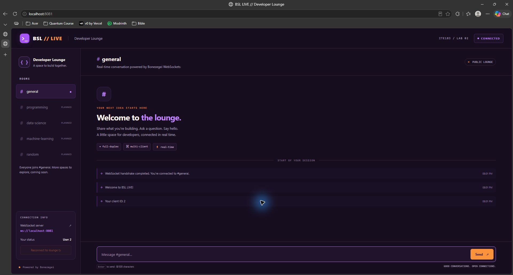
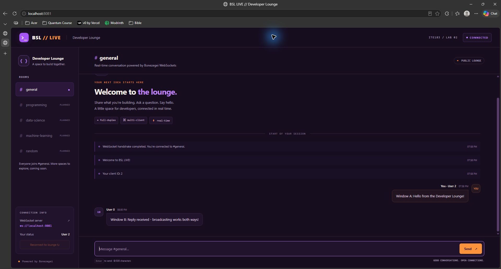
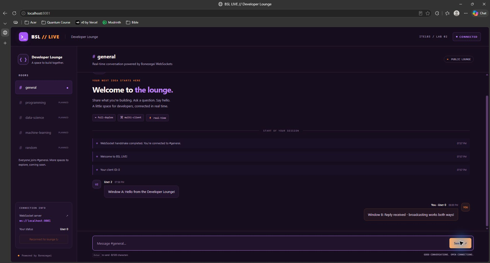
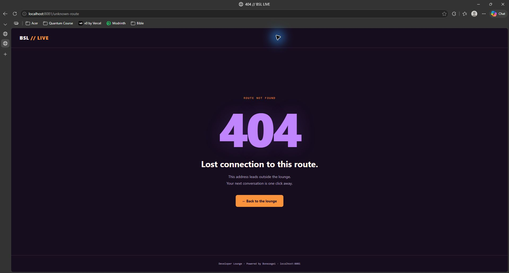
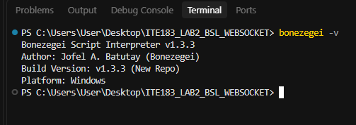
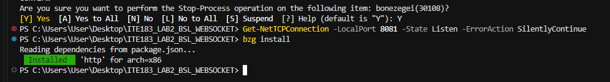
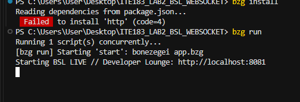
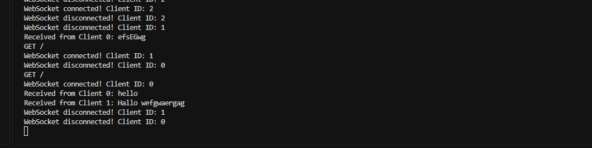
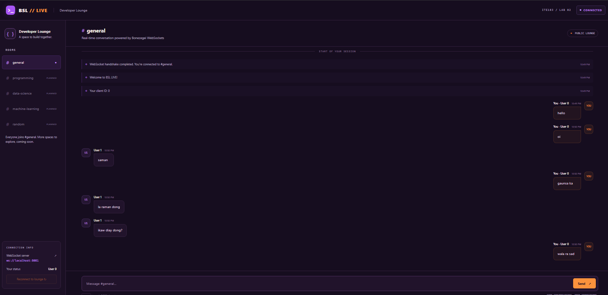
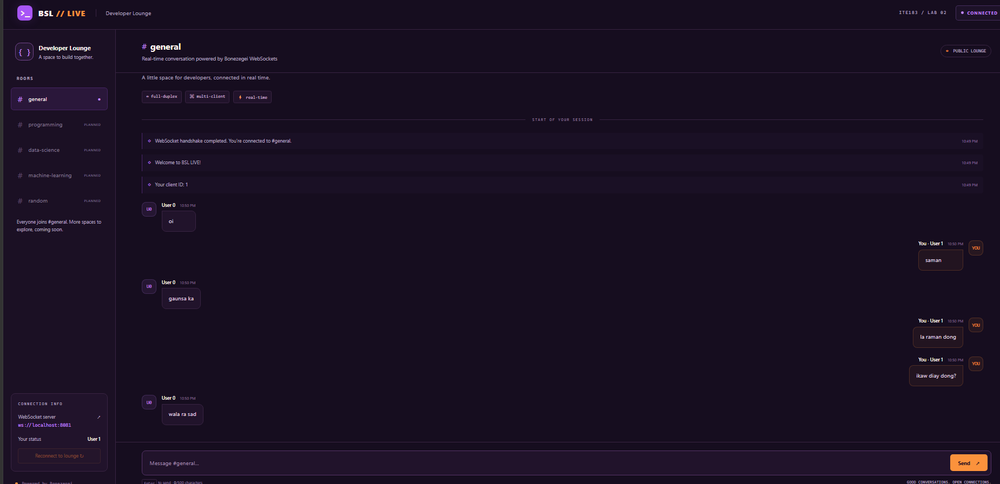

# ITE183 Laboratory 2: WebSocket Server

**Application:** BSL LIVE // Developer Lounge  
**Verification:** October 19, 2026 (Asia/Manila)  
**Project:** `C:\Users\User\Desktop\ITE183_LAB2_BSL_WEBSOCKET`  
**Required public repository:** `ITE183_Lab2_Websocket` (not published)

## 1. Current result

The existing application runs with **Bonezegei v1.3.3** on port **8081**. Installation, server execution, exact static HTML serving, HTTP **200/404**, actual HTTP-to-WebSocket upgrades, distinct active client IDs, bidirectional broadcasting, Unicode/extended frames, disconnect handling, and client rejoining all pass. Two independent same-machine Edge windows exchanged messages in both directions with correct author labels. All ten supplied images have been decoded, visually reviewed, and embedded below.

The earlier `bzg install` failure is **resolved**: Windows locked the native DLL while this server was running. After backing up the original library and stopping only the Lab 2 process, the same manifest installed successfully. The application was restarted with the installed library and passed the live tests.

**Evidence status:** all ten supplied screenshots are present, readable, and visually verified. The updated lifecycle screenshot shows connection, message, and disconnection events. Together with the real test results, the required local functionality and screenshot evidence are complete. Publication of the separate repository remains reserved for a later authorized session. No Git initialization, staging, commits, pushes, remote changes, or GitHub writes occurred. The interface, application source, port, and host-derived socket URL were not changed in this follow-up. Lab 1 and unrelated processes were untouched.

## 2. Requirements and architecture

The primary requirements were the accessible local professor's *Laboratory 2_ WebSocket Server (1).pdf*, 11 pages, reviewed in the initial verification. All pages were extracted; requirement and rubric pages 3 and 11 were also visually inspected. The handout was not copied into the repository.

| Handout pages | Requirement |
| --- | --- |
| 1 | Event-driven full-duplex server, handshake, IDs, connection lifecycle, broadcasting |
| 2 | BSL v1.3.3; `bonezegei -v`, `bzg install`, `bzg run` |
| 3 | New public repository, README, MIT License, `.gitattributes`, manifest, server and public files |
| 4-10 | Reference callback/manifest/frontend structure and concurrent browser testing |
| 11 | Repository URL, terminal and browser screenshots; functionality 70%, documentation/deliverables 30% |

The implementation follows the [professor's reference](https://github.com/msuiit-ph/BSL_HTTP_and_WebSocket). The user's explicit requirement to preserve **8081** takes precedence over the template's example port 8000.

`app.bzg` includes the native HTTP loader and creates `http(8081)`. HTTP `GET /` serves `public/index.html`. Undefined routes send the exact themed `public/404.html` with status 404. The initial finalization corrected the fallback's former status 200 using `sendResponse(readFile(...), "text/html", 404)`; no further app changes were needed here.

The browser derives the socket host from `window.location.host`, selecting `ws:` for HTTP and `wss:` for HTTPS. The native library performs the upgrade and invokes registered callbacks while `server.run()` remains active:

- `onConnect(clientId)` logs the connection and privately sends welcome and identity notices with `send`.
- `onData(message, clientId)` logs the payload and broadcasts `User <id> says: <message>` with `sendAll`.
- `onDisconnect(clientId)` logs the departed connection; other connections remain active.

The persistent socket allows full-duplex messaging without polling or reloads. IDs distinguish active connections and may be reused after disconnect. They are not authenticated accounts. The frontend recognizes its own echo by client ID, renders each broadcast once, and inserts received text using `textContent`. Only #general is implemented; other rooms are marked planned.

## 3. Exact installation diagnosis and safe resolution

### Configuration comparison

The local `package.json` is valid JSON. Its `main: app.bzg`, `start: bonezegei app.bzg`, and `http: ^1.0.0` match the [reference manifest](https://github.com/msuiit-ph/BSL_HTTP_and_WebSocket/blob/main/package.json). Branding fields differ intentionally. The reference has a trailing comma after the dependency; the local manifest correctly omits it. No dependency-name or entry-point correction was needed.

`lib/http.json` is native API/linter metadata, not the package install manifest. It contains the upstream label `name: Socket`, version `1.0.1`, and HTTP/WebSocket method descriptions. A successful clean installation produced byte-identical metadata and loader files, so that misleading upstream label was left unchanged. This metadata also contains upstream trailing commas; it is not evidence that the valid project manifest is broken.

The installed distribution contains interpreter, package manager, and linter executables. The package manager help exposes install/run commands; binary inspection identifies its embedded package index endpoint:

```text
https://raw.githubusercontent.com/bonezegei/Bonezegei_Scripting_Language/refs/heads/main/Package/package.json
```

The index maps `http` to `bonezegei/BSL_HTTP`, with OS/architecture `all`. The installer selects `bin/x86/http.dll` for this Windows installation. WinHTTP proxy inspection reported **Direct access (no proxy server)**; no BZG/BONEZEGEI environment overrides were found. The index returned HTTP 200 via both Node HTTPS and Windows WinHTTP when network access was available. The same manifest succeeded in `tmp/install-investigation/` with the server still running, demonstrating that neither the package definition nor the download was the code=4 failure.

### Failure mechanism

The actual installed **bzg 1.0.2** binary's `install_package` function was inspected read-only. Its output-file `fopen` call is at `0x1400029e7`; the failed-open branch at `0x1400029f7` reaches the return-4 block at `0x140002ec8`. Download failures return a different code. A concise [code-path excerpt](evidence/installer-code-path.txt) and [diagnostic record](evidence/installation-diagnosis.json) preserve this evidence.

A non-truncating `fs.openSync('lib/http/http.dll', 'r+')` probe returned **EBUSY: resource busy or locked**, without writing any bytes. The DLL had the Archive attribute, not ReadOnly, and its access rules permitted modification. The active Lab 2 process had loaded that native DLL. Windows therefore prevented the installer from opening it for replacement. This was the exact cause of the project-root **code=4** failure.

The earlier failure returned process exit **0** despite printing failure. It must not be reported as success. Its [actual output](evidence/installation.txt) remains preserved.

### Resolution performed

1. Copied the original working DLL, loader, and metadata to **`.tools/original-http-library/`**, retaining the original library without deletion. This is an ignored local rollback copy.
2. Verified and stopped only the previously task-created Lab 2 process, PID **28840**. Ports 8000 and 8080 were not changed.
3. Ran the unchanged project's `bzg install` with network access at the project root. It reported **Installed 'http' for arch=x86**, exit **0**. See [successful install output](evidence/installation-server-stopped.txt).
4. Restarted with `bzg run`. The follow-up listener belongs to Bonezegei PID **30108**, port **8081**; PIDs are session-specific. Independent HTTP and WebSocket tests confirm actual service.
5. Retested using the installed DLL. Both live and frontend checks passed; the linter exited 0. The original loader and metadata remain byte-identical.

| Native DLL | Size | SHA-256 |
| --- | --- | --- |
| Original preserved backup | 7,024,507 bytes | `59568451d6c080a982767901da97d0ad5b6d79cd032f3c0f87be09451ada5961` |
| Installed active DLL | 7,098,354 bytes | `f589d7db9dad55255c8f694ff04b62a1e01754b60862b56799d2ceb39b05f1ca` |

Future installations must run **before** starting this server. The download follows the upstream main-branch package; these hashes identify what was actually tested. Cross-platform installation and TLS deployment were not tested.

## 4. Final verification

| Requirement | Result | Evidence |
| --- | --- | --- |
| BSL v1.3.3 | PASS | [Version output](evidence/version.txt) |
| `bzg install` | PASS with Lab 2 stopped; prior locked-DLL failure explained | [Success](evidence/installation-server-stopped.txt), [diagnosis](evidence/installation-diagnosis.json) |
| `bzg run`, actual port 8081 | PASS | [Current startup/lifecycle](evidence/server-followup.txt), [listeners](evidence/listeners-followup.txt) |
| Main static HTML | PASS: HTTP 200, HTML type, exact source contents | [Root headers](evidence/http-root-headers.txt), [live test](evidence/smoke-followup.txt) |
| Custom fallback | PASS: HTTP 404 and exact source contents | [404 headers](evidence/http-404-headers.txt), screenshot below |
| WebSocket upgrade | PASS: HTTP 101 and calculated `Sec-WebSocket-Accept` | [Final live audit](evidence/final-audit-smoke.txt) |
| Unique active client IDs | PASS: protocol clients 3/4; browser windows 2/0 | [Final live audit](evidence/final-audit-smoke.txt), [browser observations](evidence/browser-verification.json) |
| Multi-client broadcasting | PASS in both directions, sender echo once, Unicode, extended frames | [Final live audit](evidence/final-audit-smoke.txt) |
| Disconnect handling and rejoin | PASS: survivor stays active, replacement receives broadcast | [Final live audit](evidence/final-audit-smoke.txt), [server output](evidence/server-followup.txt) |
| Real independent browser windows | PASS: same-machine Edge windows exchanged both messages | Two genuine chat captures below |
| Browser fallback return link | PASS: returned to `/` and CONNECTED | [Browser observations](evidence/browser-verification.json) |
| Frontend behavior checks | PASS, exit 0 | [Client check](evidence/client-followup.txt) |
| BSL linter | PASS, exit 0, informational API messages | [Linter](evidence/lint-followup.txt) |
| README, MIT, BSL language mapping | Prepared/preserved locally | Root project files |
| Four terminal screenshots | PASS: version, install success, startup, and complete lifecycle callbacks visible | [Visual inventory](screenshots/README.md) |
| New public repo and submission URL | NOT PUBLISHED | [GitHub preparation](GITHUB_PREPARATION.md) |

Tests used **Node 24.11.1**, built-ins only; Node is not the application server. `node tests/smoke.mjs` uses actual TCP/WebSocket clients and validates the upgrade accept value, exact HTTP bodies, broadcasts and disconnect/rejoin behavior. `node tests/client.cjs` uses a simulated DOM for lifecycle handlers, disabled controls, whitespace rejection, identity/echo behavior, safe text insertion, scrolling, drafts, reconnect initiation, and host/protocol selection.

Actual Edge interaction separately demonstrated browser delivery and author labels. During the controlled reinstall, already-open browser clients retried and reconnected; no dedicated reconnect screenshot or exhaustive retry-timing test is claimed. The native library's current startup output differs from the original library's listening message, so listener inspection and successful requests establish service rather than relying on a printed banner.

## 5. Genuine browser screenshot evidence

Captured from Microsoft Edge on the same Windows machine as the server. These are original JPEG window captures returned by the tool, saved without image generation, compositing, or editing. Window IDs and screenshot hashes are recorded in [browser-verification.json](evidence/browser-verification.json).

### Connected interface

The page at localhost:8081 shows CONNECTED, the WebSocket endpoint, welcome/handshake notices, and client ID 2. The existing purple/orange design is unchanged.



### Independent browser window A

Window A (User 2) sent **Window A: Hello from the Developer Lounge!**. Its screenshot shows the outgoing echo and the incoming reply from User 0, once each.



### Independent browser window B

Window B (User 0) received A's message and sent **Window B: Reply received - broadcasting works both ways!**. Its separate capture shows the same two-way conversation with the opposite incoming/outgoing labels. Both windows were concurrently connected; they were not two views of one socket.



Both exact browser messages also appear in the [server transcript](evidence/server-followup.txt). Navigating window A away produced the `WebSocket disconnected! Client ID: 2` event; following the fallback's return link reconnected it.

### Custom 404 page

The address bar shows the actual `/unknown-route` URL and the existing themed fallback. The independent HTTP capture confirms status 404; the screenshot alone does not establish the response status.



## 6. Genuine terminal screenshot evidence

All four manually supplied terminal files exist, fully decode, and were visually inspected. The observations below are limited to what is actually visible; [screenshot-review.json](evidence/screenshot-review.json) records the assessment of all ten files.

### Version: 01-version.png

The project-root terminal runs `bonezegei -v` and prints **Bonezegei Script Interpreter v1.3.3**, build version v1.3.3, platform Windows. This confirms the required interpreter version. This image does not show the separate package manager version; that remains supported by its saved command output.



### Installation: 02-installation.png

The terminal shows a prior stop-process confirmation for the old Lab 2 process, a port-8081 listener check, and `bzg install` from the project directory. The output reads **Installed http for arch=x86**, followed by a returned prompt. It is successful-install evidence. The screenshot does not show a numeric process exit code; the separately saved actual installation output records exit 0.



### Startup: 03-server-startup.png

The capture shows `bzg run`, launch of the manifest start command `bonezegei app.bzg`, and **Starting BSL LIVE // Developer Lounge: http://localhost:8081**. An earlier `Failed to install 'http' (code=4)` is also visible above the startup. That earlier failure is retained as context and must not be mistaken for the successful install shown in 02-installation.png.

The startup banner identifies the intended port; independent HTTP/WebSocket responses and listener inspection establish actual successful service. A startup banner alone is not bind proof.



### WebSocket events: 06-server-logs.png

The user replaced this capture during the final review. The updated original was reopened, decoded, and visually inspected. It shows actual **WebSocket connected! Client ID: ...** callbacks for identified clients, **Received from Client ...** output from clients 0 and 1, and multiple explicit **WebSocket disconnected! Client ID: ...** lines. In the lower portion, the message from client 0 includes **hello**, a message from client 1 follows, and clients 1 and 0 then disconnect. GET / output is also visible.

This updated capture verifies all three requested WebSocket event categories. It is consistent with the unchanged callback implementation, the real [saved server transcript](evidence/server-followup.txt), and the passing [final live disconnect/rejoin test](evidence/final-audit-smoke.txt). Its dimensions are 1060 x 267, and its replacement hash is recorded in the screenshot audit. Startup and port selection are shown separately in 03-server-startup.png; they are not inferred from this cropped lifecycle view.



All ten supplied images are embedded exactly once in this report. No missing or generated screenshot is used. The optional 07-reconnect.png is not present or embedded.

## 7. Evidence inventory and preservation

Current evidence: [installation diagnosis](evidence/installation-diagnosis.json), [successful installation](evidence/installation-server-stopped.txt), [current server transcript](evidence/server-followup.txt), [live integration](evidence/smoke-followup.txt), [client check](evidence/client-followup.txt), [linter](evidence/lint-followup.txt), [current listeners](evidence/listeners-followup.txt), [browser observations](evidence/browser-verification.json), and [current integrity](evidence/integrity-followup.json).

Actual response headers/bodies remain in `evidence/http-root-headers.txt`, `http-root.html`, `http-404-headers.txt`, and `http-404.html`. The earlier `installation.txt`, `server-session.txt`, `smoke.txt`, and `integrity.json` are retained as historical evidence of the initial run. Their original DLL-preservation result describes that earlier run; the follow-up integrity record identifies the later installed DLL and preserved original backup.

The stored server transcripts come from the execution tool's real terminal output, with terminal control sequences removed and terminal line wrapping retained. They are not screenshots. Both HTML files, `app.bzg`, and `package.json` remain unchanged in this follow-up and submission audit. The official install updated only its native dependency outputs; loader and metadata hashes are unchanged. Lab 1 archives and their PNGs, the old manual server, and unused socket libraries have been moved inside the project to ignored `.local-archive/lab1/`, keeping them out of publication while preserving them. The two earlier Lab 2 proof PNGs were visually verified and moved to `screenshots/` as supplemental evidence.

Other listeners stayed on **8000/PID 6260** and **8080/PID 5032** during verification. They were not terminated or reconfigured. The original library backup and diagnostic downloads are in ignored `.tools/` and `tmp/` directories; the active DLL and MIT notice remain eligible for the separate Lab 2 repository.

## 8. Before GitHub submission

All ten supplied images, including the updated lifecycle image with explicit disconnect events, have been verified and embedded. Review the repository file selection, then publish only the separate public **ITE183_Lab2_Websocket** repository in a later authorized session and verify its public URL. No repository URL is claimed as published here. Do not modify or reuse the Lab 1 remote.

Application scope remains one shared room, connection-scoped IDs, session-only history, and a browser-only length constraint. Authentication, persistent storage, TLS hosting, broad WebSocket conformance, load testing, and other operating systems were not assessed. GitHub Pages cannot execute this native BSL server.

## 9. Submission audit, challenges, and conclusion

### Latest non-disruptive verification

The final audit reran the existing integration test against the user-started server without restarting it. [The actual output](evidence/final-audit-smoke.txt) records exit 0: exact HTTP 200/404 bodies, valid WebSocket upgrades/accept values, distinct IDs 2 and 3, broadcasts in both directions, sender echo, Unicode/extended frames, survival after another client disconnects, and successful replacement-client delivery. The optional [frontend check](evidence/final-audit-client.txt) and [linter](evidence/final-audit-lint.txt) also exited 0. The existing listener was PID 34684 on 8081, reflecting the user's manual restart before this audit. No process was stopped or started by this final audit. Existing 8000/8080 listeners were untouched.

Installation success was confirmed from the actual saved stopped-server installation output and the active DLL's matching recorded hash. Installation was not rerun during this audit, avoiding another DLL lock or unnecessary service restart.

### Supplemental original chat captures

Both original proof images decode and are relevant to Lab 2. They show matching conversation views for Users 0 and 1 on ws://localhost:8081. They predate the current audit and are supplemental chat evidence, separate from the four terminal captures now verified.





### Challenges and solutions

| Challenge | Resolution / current status |
| --- | --- |
| Installer code=4 | Diagnosed loaded-DLL output-file lock; backed up original library, stopped only Lab 2, installed successfully, restarted and retested |
| Earlier fallback returned status 200 | Existing 404 file now sent with explicit HTTP 404; confirmed again in live audit |
| Browser capture environment | Same-machine Edge accessed localhost; real two-window exchange and fallback were captured |
| Terminal capture verification | All four supplied files exist and are embedded; updated lifecycle image verifies connect/message/disconnect lines; startup image accurately labels the earlier install failure as context |
| Legacy material mixed with Lab 2 | Preserved in ignored local archive; removed from proposed publication contents |
| Submission hygiene | Audited required files, hashes, image purposes, local links, publication candidates, and credential patterns; details in [readiness report](SUBMISSION_READINESS.md) |

### Conclusion

The application meets the verified functional requirements for event-driven HTTP/WebSocket serving and real-time multi-client communication on BSL v1.3.3. Installation succeeds when its native DLL is not loaded by a running server. The design and current application remain intact, and the latest live audit passed without restart. The code and local submission organization are prepared for the separate ITE183_Lab2_Websocket repository. All ten supplied screenshots are readable and accurately captioned. The version, installation, startup, browser messaging, and custom fallback evidence is complete. The updated lifecycle image completes the requested disconnection visual evidence. Disconnection/rejoin behavior also passed the live test and is recorded in actual text logs. All requested local documentation evidence is now complete; only later authorized GitHub publication and submission remain. No repository was created or published and no staging, commit, or push was performed.

## 10. References

- Primary: professor's *Laboratory 2: WebSocket Server* handout, pages 1-11; local Downloads copy reviewed previously.
- [Professor's reference](https://github.com/msuiit-ph/BSL_HTTP_and_WebSocket) and [manifest](https://github.com/msuiit-ph/BSL_HTTP_and_WebSocket/blob/main/package.json)
- [Bonezegei Scripting Language](https://github.com/bonezegei/Bonezegei_Scripting_Language) and [official package index](https://github.com/bonezegei/Bonezegei_Scripting_Language/blob/main/Package/package.json)
- [HTTP native package](https://github.com/bonezegei/BSL_HTTP) and [BSL standard library](https://bonezegei.com/tutorials/bsl/stdlib)
- [Project MIT License](../LICENSE) and [HTTP library MIT notice](../lib/http/LICENSE)
